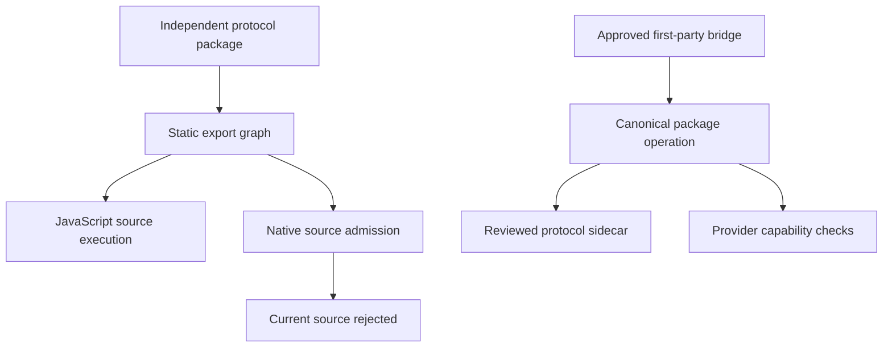
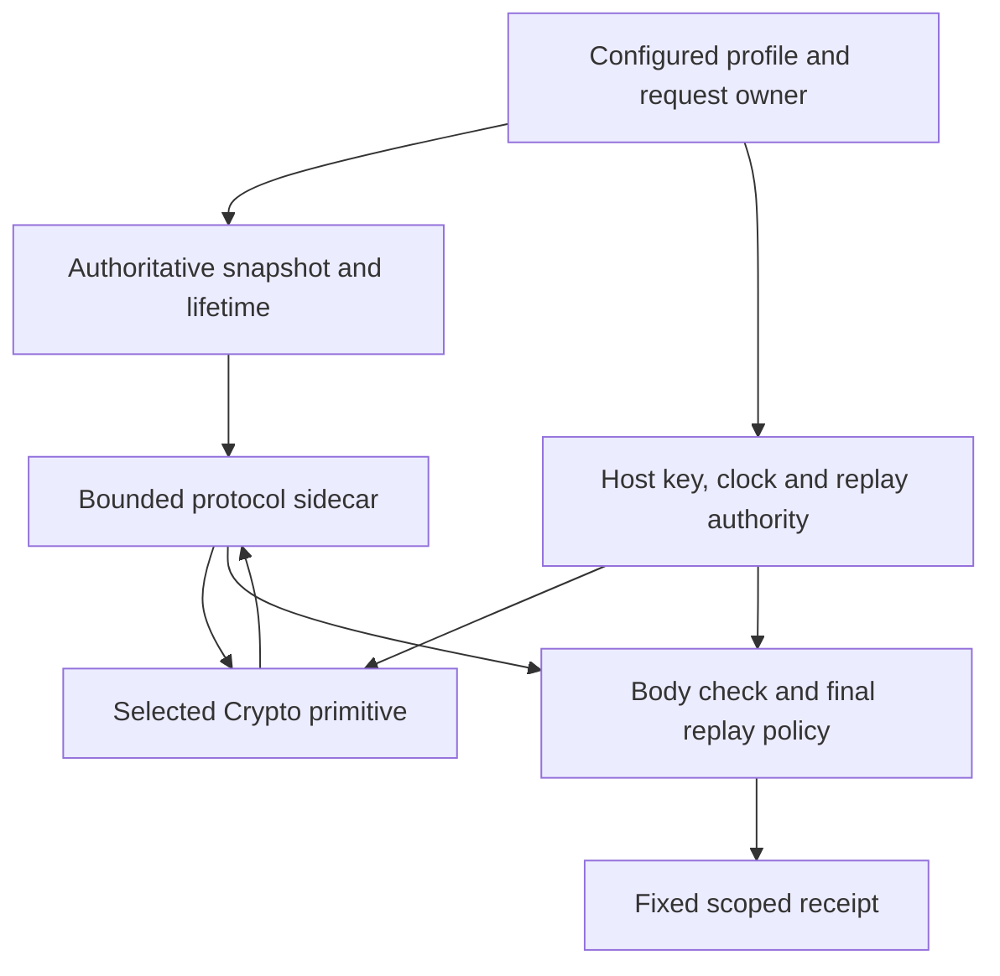

# Pulse integration decision (HMS-07)

**Historical checkpoint.** The findings below describe the pinned HMS-07 tree.
Pulse has since merged trusted external lowerer admission and 64 KiB HMAC input;
the synchronized first-party bridge/pin proposal below is superseded. See the
[HMS-08 runtime contract proposal](hms-08-contract.md) for the remaining host and
runtime boundary. The original measurements and receipts are unchanged.

**NO-GO for compiling the current protocol unchanged or automatically starting
HMS-08. Conditional GO for a narrow, explicitly approved HMAC first-party bridge.**
The required cryptographic primitive already works. The remaining decisions are
package lowering, authoritative HTTP capture and request-owned capability binding.
Broad compiler expansion, generic HMAC exposure and arbitrary plugin discovery
are unnecessary for the proposed path.

The investigation pins Pulse `latest` at
[`e6a78640928a93f0e41813f55d9847895ea9be41`](https://github.com/pulse-compute/pulse/commit/e6a78640928a93f0e41813f55d9847895ea9be41)
and this package after merged HMS-06 at
`7d7826468ecf46f2f2de35cf03bd48b252cd573e`. Pulse is read-only.
The current release manifest identifies Crypto/JWT/S3 and their support policy;
resolvable `/provider` and `/pulsewasm-native` modules remain toolchain internals.
No Pulse mutation Entry Point matches this cross-owner investigation; it uses
the ordinary read-only instruction chain, classified as evidence/documentation.

## What was proved

The [reproducible spike](../spikes/hms-07/README.md) and
[machine receipt](evidence/hms-07-feasibility.json) establish:

| Observation | Result and scope |
|---|---|
| Internal JS HMAC byte output + Crypto verification | Exact RFC B.2.5; explicit SubtleCrypto; changed base rejected |
| Unchanged Pulse HMAC source compiled to Wasm | Exact RFC B.2.5 sign/verify through existing Native binder; explicit realization, no fallback |
| Strict profile with either backend | JS protocol signs/verifies required body digest; changed body and replay rejected |
| Native source graph for the actual package export | Rejected with `PULSE_NATIVE_IMPORT_UNSUPPORTED` in eight modules |
| Native syntax/context probes | Two controls accepted as plans; eight unsupported cases rejected with exact codes below |
| JavaScript source graph and inspection | Accepted; no generated Native execution or provider qualification inferred |
| Existing Node request budget | A late successful result cannot continue after `PULSE_REQUEST_DEADLINE_EXCEEDED` |
| Normalization examples | Dot segments disappear through URL construction; Headers combines duplicate values; text decoding/re-encoding changes invalid UTF-8 bytes |

The Wasm probe executes only Crypto in Wasm. Canonicalization, policy and the
replay fixture remain JavaScript. Its synthetic crypto selection is not a
compiler-generated application plan. The fixed RFC example is a primitive
fixture; the separate strict-profile case includes the required body policy.
The test replay store is not a durable production store.

## Compiler and package boundary

Current Pulse supports independent, versioned npm **static source** imports.
This package resolves through its exact `/protocol` export, then fails Native
admission because it has module initialization and captured values. Eight
observed files are protocol, base-engine, signature-fields, algorithms,
base-support, target, structured-field and profile. Deleting initializers would
not make the remaining typed-array, Map, regex, class/error and callback-based
implementation a supported Native program. The focused probes establish
additional failures without claiming an exhaustive compiler analysis.

| Probe | Observed diagnostic / result |
|---|---|
| Actual npm source graph | `PULSE_NATIVE_IMPORT_UNSUPPORTED`: static functions/types are allowed; module initialization/captured values are not |
| `new Uint8Array`, `new Map`, regex literal/`.test`, callback/direct call | `PULSE_CANONICAL_NATIVE_EXPRESSION_UNSUPPORTED` |
| `try/catch` | `PULSE_CANONICAL_CONTROL_FLOW_UNSUPPORTED` |
| `await signer.sign(...)` | `PULSE_NATIVE_AWAIT_UNSUPPORTED` |
| `ctx.req.rawTarget`, `ctx.req.trailers` | `PULSE_CANONICAL_NATIVE_EXPRESSION_UNSUPPORTED`: absent context contract |
| `ctx.text(...)`, `ctx.req.headers` | Accepted `pulse.canonical-native-plan.v9`; plan evidence, not emitted application Wasm |

Source links: [static npm contract][P1], [graph admission][P2],
[Native expression planning][P3], [control-flow ownership][P4].

The lower path is a proposal, not installed support. Package metadata cannot
create it: the trusted catalog currently contains Assets, Crypto, Entities,
GRIP, JWT and S3. `http-signatures` is absent. Discovery also checks exact
package/toolchain version equality and the canonical contained manifest path.
The request-owned package-effect catalog separately has no HMS operation.
See [trusted catalog][P5], [discovery/version checks][P6] and [effect catalog][P7].

Independent versioning can remain intact by using a **separate synchronized
first-party bridge** in Pulse, with a provisional identity such as
`@pulse-compute/http-signatures-pulse`. The bridge owns the trusted builder,
canonical operation and reviewed source mapping, while this repository owns
protocol semantics, reference implementation, fixtures and a future narrow
Native sidecar. Pin the independent package version/content hash and schema in
the bridge; updates require an exact compatibility/conformance gate. The bridge
version follows Pulse, not the external protocol package. For a private spike,
an exact private artifact can be reviewed without publication or support promotion.
This packaging/ownership decision needs human review; it is not an existing
registration route. Merely adding a manifest to this independent package would
neither satisfy the catalog nor preserve independent versions under today's
synchronized-loader rule.

## Cryptographic seam and bounds

[Crypto's internal provider seam][P8] already returns SHA-256/HMAC-SHA256 bytes.
[S3][P9] supplies resolved host credentials and selected primitives for SigV4;
JWT supplies named secret bindings and provider wall time, with separate
package-owned [lowering][P10] and [Native protocol source][P11]. These establish
ownership patterns, not permission for a new package operation.

| Existing primitive | Exact reusable bounds / constraint |
|---|---|
| HMAC byte signing | Key 0–8,192 bytes internally; data at most 32,768 bytes; output 32 bytes |
| HS256 verification | Key 32–4,096 bytes; data at most 1,048,576 bytes; tag exactly 32 bytes |
| SHA-256 byte digest | At most 2,097,152 input bytes; 32-byte output |
| Proposed initial HMS overlap | Enforce key 32–4,096 bytes, signature base at most 32,768, signature exactly 32; retain narrower body/profile limits |
| Package's current maximum base | 65,536 bytes: must be explicitly lowered for the existing signing seam |

Use both `HMAC-SHA256` (byte output) and `HS256` (verification), plus `SHA-256`
for body integrity, in explicit compiler/provider requirements. These Pulse
identifiers map deliberately to RFC `hmac-sha256`; they are not incoming aliases.
No public generic HMAC effect or new algorithm is needed for a trusted package
bridge. Supporting bases above 32 KiB would be a separate Crypto contract change.

The unchanged [Native source/binder][P12] produces the published tag and rejects
32,769 signing bytes. The [Native verifier wrapper][P13] stages secret bytes
inside Crypto memory and wipes its staging region; this is not an opaque-key
HSM API. It grows linear memory per verification: the recorded call increases
2,424,832 to 2,555,904 bytes. A future bridge needs invocation/lifetime and
allocation-budget qualification; this probe is not a production memory bound.
Raw key material must never become an application value, effect payload,
compiler input, report, diagnostic or receipt. Private provider-to-Crypto
staging must stay behind the reviewed boundary. If that cannot be maintained,
HMS-08 is a no-go; do not pass `ctx.secret.get()` output into guest protocol code.

P-256 and RSA v1.5 remain reference-package support from HMS-06. Pulse has
separate signing/verification internals, but their Native guest-link composition
and smaller input limits have not been qualified for HMS. Keep them out of the
first bridge. PSS/Ed25519 do not gain support from this investigation.

## HTTP and host authority gaps

The public [PulseRequest][P14] supplies method, URL, path and ordered string
header pairs, plus text/JSON reads or an opaque body marker. It does not expose
an original-target/trailer snapshot or general body bytes. The host must supply
authentic provenance and explicit unavailable states; application records alone
cannot establish them.

| Input | Current evidence | Required bridge rule |
|---|---|---|
| Method | Node adapter uppercases it; public context provides a string | Admit a documented method subset or capture original semantics; never silently change a case-sensitive method |
| URI / original target | Node builds `new URL(raw, origin)`; dot segments normalize; public context lacks raw target | Capture raw target and trusted effective scheme/authority before normalization. Define proxy termination explicitly; no forwarded-header inference |
| Ordinary fields / `;bs` | Node preserves rawHeaders pairs alongside Web Request. Fastly JS defaults to `Headers.entries()`; Native Fastly has multi-value ABI enumeration | Use a provider-owned complete ASCII snapshot preserving per-name instance order. Reject ambiguous/normalized inputs where required semantics cannot be proved |
| Structured selectors | Package parser works over authoritative field values | No additional host authority from `;sf`/`;key`; defer these selectors in the first Native subset |
| Trailers / `;tr` | No public trailer snapshot | `unavailable`; do not substitute headers or empty known-present trailers |
| Body integrity | Text/JSON are decoded representations; body forwarding is opaque | Borrow/copy exact bounded transport content before decoding under the existing body owner. No implicit unbounded buffer, stream drain, reserialization or tee |
| Response / `;req` | Response status exists, but no HMS associated-request snapshot handle | Defer response/cross-request signatures until request association and lifetime are explicit |
| Outbound signing | Package returns fields, does not transmit | Host freezes the intended message and installs fields once; later mutation or transport rewriting invalidates the proof |

Sources: [Node adaptation][P15], [Fastly JS header source][P16],
[Fastly Native enumeration][P17]. The Fastly source demonstrates a seam, not
byte fidelity on Viceroy or a deployed host. RFC required inputs that cannot be
captured remain `COMPONENT_UNAVAILABLE`; unsupported profile features must not
be silently weakened. The initial Native component subset needs its own clear
`UNSUPPORTED_COMPONENT` result, not an invented successful empty value.

Trusted time is **wall time**, sampled once and converted to safe integer epoch
seconds. It is distinct from the host's monotonic request deadline. JWT's
[provider wrapper][P18] is the precedent for named secret resolution, one wall
clock sample, redaction and cancellation checks before/after asynchronous work.
The new bridge must bind profile/key ID/trust domain to configured authority,
not accept a wire keyid as a secret name. Missing authority fails closed.

Cancellation must revoke the whole request-owned operation, fence late results
and prevent post-cancellation replay consumption. Existing [Node budgets][P19]
provide the lifecycle mechanism, not CPU preemption for synchronous Wasm. The
standalone protocol's ordinary async call does not become a Pulse effect simply
because it is imported. Fastly JS currently rejects request deadline options
with `PULSE_REQUEST_DURATION_UNSUPPORTED`; a first bridge must not promise this
lifecycle parity. Emit bounded fixed HMS error codes as operation results;
transport cancellation remains a Pulse execution failure. Never expose backend
exceptions, signature bases, body bytes or keys as diagnostics.

Atomic replay remains host-owned. Existing conditional KV is a possible
primitive, not a proven HMS store: retention through the inclusive deadline,
atomic consume, shared-instance scope, expiry recheck and cancellation ordering
need dedicated qualification. Use explicit `replay:none` for a limited first
proof unless that store contract is supplied; preserve the `not-checked` receipt.
Never advertise the in-memory fixture as production replay protection.

## Smallest proposed end-to-end path

A Node-first HMAC proof can stay inside existing constrained execution by
porting a narrow package-owned protocol subset into an audited sidecar, using
fixed first-party package effects and current Crypto primitives. It does not
compile the current JS parser unchanged. The fixture host owns both outgoing
and incoming messages; it signs an immutable outgoing snapshot and sends those
exact fields/content to the verifier. Production fetch-sign-send integration
is a separate transport/lifetime decision, not implied by returning headers.

Only a snapshot/opaque reference and bounded policy identifiers cross the
application boundary; resolved keys and provider SDK objects do not. An
illustrative future call is `await signatures.verify(ctx, {profile: 'webhook-v1'})`
from the synchronized bridge. This is a design sketch, not an exported API or
permission to invent a lowerer today.

Proposed first profile: HTTPS request only, one configured label/algorithm,
`@method`, `@target-uri`, plain `content-digest`, required created/expires/keyid/
alg/tag, SHA-256 body integrity, base at most 32 KiB, body at most 64 KiB, key
32–4,096 bytes. Keep existing field/work bounds or explicitly lower them.
Response binding, trailers, binary field wrapping, structured selectors,
parameterized query extraction and asymmetric algorithms remain excluded until
their own receipts exist. Replay is explicitly required with a qualified store
or explicitly none; no downgrade on missing storage.

| Proposed step | Smallest owner changes | Approval / proof required |
|---|---|---|
| HMS-08A protocol realization | This package: bounded sidecar, fixed result ABI, shared JS/Native positive/negative vectors | Approve duplicate realization ownership and narrow profile; no general compiler changes |
| HMS-08B trusted bridge | Pulse package/lowerer owners: synchronized facade/manifest/builder, exact external artifact pin, trusted catalog and package-effect registration | Explicit protected-boundary review; independent repo/namespace gives no trust |
| HMS-08C Node authority adapter | Node/runtime owners: raw target/field/body capture, private key binding, wall clock, request budget, error redaction and optional atomic replay | Approve new snapshot/operation contract and borrowing lifetime; no secret in application payload |
| HMS-08D qualification | Package + Node owners: emitted Native app sign/verify, real host normalization, missing capabilities, cancellation, memory and negative parity | Native acceptance required before any support claim; Fastly and asymmetry remain separate |

These are proposed subdivisions of HMS-08, not filed issues or authorized Pulse
changes. Prefer extending the existing canonical package-operation route and
reusing Crypto's private primitives. If implementation instead needs arbitrary
JS classes/regex/callbacks, plugin discovery, a hidden interpreter, general
secret-byte exposure or widened global crypto, stop for a new decision.

## Target-by-target checkpoint

| Lane | Protocol/import evidence | Crypto evidence here | Host/authority and lifecycle | HMS integration status |
|---|---|---|---|---|
| Node JavaScript | Reference passes; actual Pulse graph admits import/inspection | Pulse JS byte seam + explicit verifier pass | No installed HMS request-owned effect/snapshot/key adapter | unavailable as Pulse integration; reference remains supported |
| Fastly JavaScript | No HMS target execution | Existing source contract only; not run | Headers normalize; deadline option unsupported; no HMS adapter | unavailable / unqualified |
| Node Native | Current source graph rejected; isolated syntax diagnostics | Actual unchanged HMAC Wasm passes in Node | No HMS lowerer/snapshot; allocation, secret and replay lifetimes unqualified | unavailable; primitive success is not Native package support |
| Fastly Native / Viceroy | No HMS artifact or host run | Existing source selection precedent only | Raw multi-value header seam exists; target/body/secret/lifecycle HMS proof absent | unavailable / unqualified |

The [machine-readable matrix](evidence/hms-07-targets.json) keeps these scopes
separate. No Pulse source, provider, ABI, manifest, trust catalog or release
metadata changes are included. Human approval of the bounded bridge/host design
is the dependency for HMS-08; HMS-07 itself is complete with this no-go checkpoint.

[P1]: https://github.com/pulse-compute/pulse/blob/e6a78640928a93f0e41813f55d9847895ea9be41/docs/architecture/current-contracts.md#declared-npm-source-exports-imp9-01
[P2]: https://github.com/pulse-compute/pulse/blob/e6a78640928a93f0e41813f55d9847895ea9be41/wasm/packages/compiler/src/project/reachable-graph-builder.js
[P3]: https://github.com/pulse-compute/pulse/blob/e6a78640928a93f0e41813f55d9847895ea9be41/wasm/packages/compiler/src/canonical-native-plan.js
[P4]: https://github.com/pulse-compute/pulse/blob/e6a78640928a93f0e41813f55d9847895ea9be41/wasm/packages/compiler/src/spine/handler-ir.js
[P5]: https://github.com/pulse-compute/pulse/blob/e6a78640928a93f0e41813f55d9847895ea9be41/wasm/packages/contracts/src/library/manifest.js
[P6]: https://github.com/pulse-compute/pulse/blob/e6a78640928a93f0e41813f55d9847895ea9be41/wasm/packages/library-kit/src/compiler/handler-library-contracts.js
[P7]: https://github.com/pulse-compute/pulse/blob/e6a78640928a93f0e41813f55d9847895ea9be41/packages/runtime/src/internal/package-runtime.js
[P8]: https://github.com/pulse-compute/pulse/blob/e6a78640928a93f0e41813f55d9847895ea9be41/packages/crypto/src/provider.cjs
[P9]: https://github.com/pulse-compute/pulse/blob/e6a78640928a93f0e41813f55d9847895ea9be41/packages/s3/src/signing.js
[P10]: https://github.com/pulse-compute/pulse/blob/e6a78640928a93f0e41813f55d9847895ea9be41/packages/jwt/pulsewasm.compiler.cjs
[P11]: https://github.com/pulse-compute/pulse/blob/e6a78640928a93f0e41813f55d9847895ea9be41/packages/jwt/as/index.as.ts
[P12]: https://github.com/pulse-compute/pulse/blob/e6a78640928a93f0e41813f55d9847895ea9be41/packages/crypto/pulsewasm.native.cjs
[P13]: https://github.com/pulse-compute/pulse/blob/e6a78640928a93f0e41813f55d9847895ea9be41/wasm/packages/host-runtime/src/runtime/native-crypto-verifier.js
[P14]: https://github.com/pulse-compute/pulse/blob/e6a78640928a93f0e41813f55d9847895ea9be41/packages/runtime/src/index.d.ts
[P15]: https://github.com/pulse-compute/pulse/blob/e6a78640928a93f0e41813f55d9847895ea9be41/packages/provider-node/src/javascript/node-adapter.js
[P16]: https://github.com/pulse-compute/pulse/blob/e6a78640928a93f0e41813f55d9847895ea9be41/packages/provider-fastly/src/javascript/runtime-host.js
[P17]: https://github.com/pulse-compute/pulse/blob/e6a78640928a93f0e41813f55d9847895ea9be41/packages/provider-fastly/src/build/native-request-headers.js
[P18]: https://github.com/pulse-compute/pulse/blob/e6a78640928a93f0e41813f55d9847895ea9be41/packages/provider-node/src/javascript/jwt-verifier.js
[P19]: https://github.com/pulse-compute/pulse/blob/e6a78640928a93f0e41813f55d9847895ea9be41/packages/runtime/src/internal/request-budget.js
